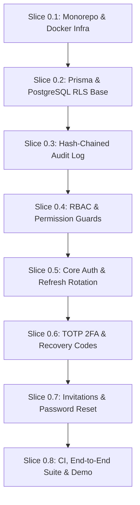

# HRVO Platform - Phase 0 Master Plan: Foundations

**Document Version:** 1.0  
**Date:** 13 October 2026  
**Status:** Pending Product Owner Approval  
**Source of Truth:** [`docs/SRS.md`](file:///run/media/macami/DataDrive/Hr%20virtual%20office/docs/SRS.md), [`AGENTS.md`](file:///run/media/macami/DataDrive/Hr%20virtual%20office/AGENTS.md)

---

## 1. Executive Summary & Phase 0 Objectives

Phase 0 (Foundations) establishes the production-grade architectural baseline for the HR Virtual Office (HRVO) platform. It delivers the monorepo workspace, local containerized infrastructure, multi-tenant database engine with PostgreSQL Row-Level Security (RLS), full authentication lifecycle (invitations, Argon2id passwords, rotating session tokens, TOTP 2FA, lockout, password reset), fine-grained Role-Based Access Control (RBAC), tamper-evident SHA-256 hash-chained audit logging, foundational UI shell with shadcn/ui, and automated CI pipelines.

Phase 0 is strictly scoped to foundation infrastructure and security. **No Phase 1 business logic (Attendance engine, Timesheets, Tasks, Documents) will begin until Phase 0 is fully delivered, tested, demonstrated, and approved by the Product Owner.**

---

## 2. Requirement Traceability Matrix (Phase 0 Scope)

| Requirement ID | Module / Area | Description | Priority |
| :--- | :--- | :--- | :--- |
| **FR-AUTH-001** | AUTH | Accounts created by invitation only; single-use token expiring in 7 days sent by email. | Must (P1) |
| **FR-AUTH-002** | AUTH | Argon2id password hashing; minimum 12 characters; breach list check (k-anonymity). | Must (P1) |
| **FR-AUTH-003** | AUTH | Short-lived JWT access tokens (15m) + rotating refresh tokens (7d) in httpOnly/Secure/SameSite cookies with reuse detection & token family revocation. | Must (P1) |
| **FR-AUTH-004** | AUTH | TOTP two-factor authentication (authenticator apps) + hashed recovery codes; mandatory for Super Admin and HR Manager. | Must (P1) |
| **FR-AUTH-006** | AUTH | Role-Based Access Control (RBAC) with granular permissions; system roles seeded; route permission guards. | Must (P1) |
| **FR-AUTH-007** | AUTH | Account lockout after 5 failed logins for 15 minutes; notification sent. | Must (P1) |
| **FR-AUTH-008** | AUTH | Password reset via single-use email link valid 30 minutes; revokes all active sessions. | Must (P1) |
| **FR-AUTH-010** | AUTH / DB | Tenant isolation enforced at database layer with PostgreSQL Row-Level Security (RLS) on all business tables. | Must (P1) |
| **FR-AUTH-011** | AUTH / AUD | Audit log emission for login, logout, failed login, lockout, 2FA, password reset, and role change events. | Must (P1) |
| **FR-AUD-001** | AUD | Append-only audit log recording actor, org, action, entity, before/after JSON (redacted), IP, user-agent, and SHA-256 hash chain (`prev_hash`, `hash`). | Must (P1) |
| **NFR-SEC-001..010**| Security | OWASP ASVS Level 2 compliance; no secrets in code; input validation via Zod; strict TypeScript mode. | Must |

---

## 3. Architecture & Security Specifications

### 3.1 Repository Structure
```
hr-virtual-office/
├── .github/
│   └── workflows/
│       └── ci.yml                 # Lint, typecheck, tests, Prisma check, audit
├── apps/
│   ├── api/                       # NestJS 10 backend (REST API, guards, Prisma)
│   │   ├── prisma/
│   │   │   ├── schema.prisma      # Multi-tenant schema
│   │   │   └── migrations/        # SQL migrations with RLS policies
│   │   ├── src/
│   │   │   ├── auth/              # Auth, invitations, 2FA, sessions
│   │   │   ├── rbac/              # Roles, permissions, guards, decorators
│   │   │   ├── audit/             # Hash-chained audit logger service
│   │   │   ├── tenant/            # RLS tenant context & Prisma middleware
│   │   │   └── common/            # Filters, interceptors, encryption helpers
│   │   └── test/                  # Unit, RLS isolation & e2e integration tests
│   └── web/                       # Next.js 14 frontend (App Router, Tailwind, shadcn/ui)
│       ├── src/
│       │   ├── app/               # (auth) routes: login, invite, 2fa, reset; dashboard shell
│       │   ├── components/        # shadcn/ui components & forms
│       │   ├── hooks/             # TanStack Query & auth state hooks
│       │   └── lib/               # API client, error handling
├── packages/
│   ├── shared/                    # Shared TypeScript types, Zod validation schemas, constants
│   └── tsconfig/                  # Shared TypeScript configuration
├── infra/
│   └── docker/
│       └── docker-compose.yml     # Local Postgres 16, Redis 7, MinIO, ClamAV, Mailhog
├── docs/
│   ├── SRS.md                     # Complete Software Requirements Specification
│   ├── PLAN.md                    # This document (Phase 0 Master Plan)
│   └── adr/                       # Architectural Decision Records (ADR 001..NNN)
├── AGENTS.md                      # Project rules & constraints
├── package.json                   # Root workspace config (pnpm + Turborepo)
├── pnpm-workspace.yaml            # Monorepo packages definition
└── turbo.json                     # Turborepo build pipeline
```

### 3.2 Tenant Isolation (PostgreSQL Row-Level Security)
- Every business table contains an `org_id UUID NOT NULL` column.
- PostgreSQL tables have RLS enabled and forced:
  ```sql
  ALTER TABLE organizations ENABLE ROW LEVEL SECURITY;
  ALTER TABLE organizations FORCE ROW LEVEL SECURITY;
  CREATE POLICY org_isolation_policy ON <table_name>
    FOR ALL
    USING (org_id = NULLIF(current_setting('app.org_id', true), '')::uuid)
    WITH CHECK (org_id = NULLIF(current_setting('app.org_id', true), '')::uuid);
  ```
- Application executes queries through a restricted non-superuser PostgreSQL role (`hrvo_app`).
- NestJS `PrismaService` uses an interactive transaction or scoped client extension that sets `SET LOCAL app.org_id = '<tenant_id>'` before executing queries.

### 3.3 Cryptographic Standards
- **Passwords:** Argon2id with recommended OWASP parameters (memory cost $\ge 64$ MB, time cost $\ge 3$ iterations, parallelism $\ge 4$).
- **MFA Secrets:** TOTP secret keys encrypted at rest using AES-256-GCM prior to database storage (`mfa_secret_enc`).
- **Audit Hash Chain:** `hash = SHA256(prev_hash || id || org_id || actor_id || action || entity_type || entity_id || before_json || after_json || created_at)`. Genesis block hash initialized to 64 zeros. Row-level table locking during insertion prevents race conditions and fork creation.

---

## 4. Phase 0 Vertical Slice Implementation Plan

Phase 0 is divided into 8 sequential vertical slices. Each slice delivers a complete, testable increment following the mandate: **migration + API + UI + tests + docs + demo script**.



---

### Slice 0.1: Monorepo Setup & Local Docker Infrastructure
- **Objective:** Establish workspace structure, strict TypeScript configs, linting, formatting, and Docker Compose local environment.
- **Scope & Deliverables:**
  - `pnpm-workspace.yaml`, `package.json`, `turbo.json`.
  - `packages/shared`: initial exports, Zod setup, tsconfig.
  - `apps/api`: NestJS 10 scaffolding with TypeScript strict mode, Fastify/Express platform, config module.
  - `apps/web`: Next.js 14 App Router, Tailwind CSS, shadcn/ui initial config.
  - `infra/docker/docker-compose.yml`:
    - PostgreSQL 16 (configured with TimescaleDB compatibility)
    - Redis 7 (alpine)
    - MinIO (S3 compatible file storage)
    - ClamAV (for upload scanning)
    - Mailhog (local SMTP server on :1025 with web UI on :8025 for email verification)
  - Root `.env.example` with documented environment variables.
  - `docs/adr/001-monorepo-and-infrastructure.md`.
- **Tests & Verification:**
  - `pnpm install`, `pnpm build`, `pnpm lint`, `pnpm typecheck` pass across all workspaces.
  - Docker Compose services start up healthily (`docker compose ps`).
- **Demo Script:** Start Docker, run `pnpm dev`, show NestJS `/api/health` responding and Next.js welcome screen rendering.

---

### Slice 0.2: Prisma Schema & PostgreSQL RLS Base
- **Objective:** Define foundational database models, apply migrations with PostgreSQL Row-Level Security, configure scoped tenant execution context, and prove isolation.
- **Requirement IDs:** `FR-AUTH-010`
- **Scope & Deliverables:**
  - Prisma models in `apps/api/prisma/schema.prisma`:
    - `Organization`, `User`, `Role`, `UserRole`, `Device`, `AuthSession`, `MfaRecoveryCode`, `Invitation`, `AuditLog`.
  - Migration script applying RLS policies (`ALTER TABLE ... ENABLE ROW LEVEL SECURITY`) and creating application role `hrvo_app`.
  - NestJS `PrismaService` with RLS tenant context wrapper (`executeInTenantContext(orgId, cb)`).
  - Shared Zod validation schemas and TypeScript types in `packages/shared`.
  - `docs/adr/002-multi-tenancy-and-rls.md`.
- **Tests & Verification:**
  - Unit tests for tenant context propagation.
  - Integration tests verifying RLS: inserting records for Org A and Org B, setting tenant context to Org A, verifying queries return Org A data only and raw queries without context return 0 records.
- **Demo Script:** Execute an automated script showing two tenants created with users; querying as Tenant A returns Tenant A only, querying as Tenant B returns Tenant B only.

---

### Slice 0.3: Tamper-Evident Audit Log Service
- **Objective:** Deliver the append-only, SHA-256 hash-chained audit logging engine with sensitive data redaction.
- **Requirement IDs:** `FR-AUD-001`, `FR-AUTH-011`
- **Scope & Deliverables:**
  - `AuditLogService` in `apps/api/src/audit`:
    - Append-only write method calculating SHA-256 hash chain: `hash = SHA256(prev_hash || log_payload)`.
    - Concurrency protection: serializes hash chaining using transactional row-level lock on the organization's latest audit log entry.
    - Sensitive data sanitizer: automatic redaction of password, tokens, credentials, and bank information in `before`/`after` JSON blobs.
    - Verification routine: `verifyChainIntegrity(orgId)` to validate the integrity of the entire chain from genesis.
  - REST endpoint for auditing (internal service + super admin read-only query endpoint).
  - UI: Basic read-only Audit Log table component in `apps/web` with filtering and chain verification status badge.
  - `docs/adr/003-tamper-evident-audit-log.md`.
- **Tests & Verification (TDD):**
  - Unit tests: Genesis hash computation, subsequent hash chaining, tamper detection (modifying a column throws hash mismatch).
  - Integration tests: Concurrency test inserting multiple audit entries concurrently without chain forks.
- **Demo Script:** Generate 5 audit events, run verification showing chain valid; simulate manual database edit on one row, run verification showing exact tampered row identified.

---

### Slice 0.4: RBAC & Permission Guard System
- **Objective:** Implement fine-grained Role-Based Access Control, system role definitions, custom permission strings, and NestJS route permission guards.
- **Requirement IDs:** `FR-AUTH-006`
- **Scope & Deliverables:**
  - Complete permission catalog defined in `packages/shared` (e.g. `org.manage`, `users.invite`, `attendance.read.team`, `timesheet.approve`, `audit.view`, etc.).
  - System roles seeded: `SUPER_ADMIN`, `HR_MANAGER`, `TEAM_LEAD`, `EMPLOYEE`, `SUBCONTRACTOR`, `FINANCE_AUDITOR`, `GUEST`.
  - NestJS Decorator `@RequirePermissions(Permission.USERS_INVITE)` and `PermissionsGuard`.
  - Tenant and User execution context decorators: `@CurrentOrg()`, `@CurrentUser()`.
  - UI: Permission gate wrapper component in Next.js (`<Can permission="users.invite">...</Can>`).
  - `docs/adr/004-rbac-and-permissions.md`.
- **Tests & Verification:**
  - Unit tests for `PermissionsGuard` with various role permission subsets.
  - Integration tests on protected mock endpoints verifying 200 OK for authorized roles and 403 Forbidden for unauthorized roles.
- **Demo Script:** Call test endpoint as Super Admin (200), call test endpoint as Subcontractor (403 Forbidden), showing audit log and error response.

---

### Slice 0.5: Core Authentication, Password Security & Session Rotation
- **Objective:** Deliver Argon2id password authentication, breach list check, rotating refresh token sessions in httpOnly cookies, token reuse detection, and account lockout.
- **Requirement IDs:** `FR-AUTH-002`, `FR-AUTH-003`, `FR-AUTH-007`, `FR-AUTH-011`
- **Scope & Deliverables:**
  - Password hashing with Argon2id; minimum 12 characters; breach list k-anonymity check (HaveIBeenPwned API with graceful offline fallback).
  - JWT Access token (15-minute expiration) and rotating Refresh token (7-day expiration) stored in `httpOnly`, `Secure`, `SameSite=Strict` cookies.
  - Refresh token family tracking in `auth_sessions`: reuse of an already-rotated token invalidates the entire token family immediately.
  - Account lockout: 5 consecutive failed logins lock account for 15 minutes; audit event emitted and notification triggered.
  - Endpoints: `POST /api/v1/auth/login`, `POST /api/v1/auth/refresh`, `POST /api/v1/auth/logout`, `GET /api/v1/auth/me`.
  - UI: Next.js Login form with Zod validation, error handling, loading states, and lockout timer notification.
  - `docs/adr/005-authentication-and-session-security.md`.
- **Tests & Verification:**
  - Unit tests for Argon2id hashing and password complexity validation.
  - Integration tests for login success, cookie assignment, token rotation.
  - Security tests for token reuse detection: replaying old refresh token revokes all user sessions.
  - Security tests for account lockout: 5 bad attempts lock account; 6th attempt rejected even with correct password.
- **Demo Script:** Sign in with valid credentials, verify httpOnly cookie; attempt 5 bad logins, demonstrate lockout; simulate token replay and verify immediate family revocation.

---

### Slice 0.6: TOTP Two-Factor Authentication & Recovery Codes
- **Objective:** Implement TOTP (RFC 6238) authenticator app support, encrypted TOTP secrets, single-use recovery codes, and mandatory 2FA enforcement for administrative roles.
- **Requirement IDs:** `FR-AUTH-004`, `FR-AUTH-011`
- **Scope & Deliverables:**
  - TOTP engine using `otplib`: QR code URI generation, time-step verification, clock drift tolerance ($\pm 1$ window).
  - At-rest encryption of TOTP secret (`mfa_secret_enc`) using AES-256-GCM.
  - Generation and hashed storage of 10 single-use 8-character recovery codes.
  - Mandatory 2FA enforcement policy: users with `SUPER_ADMIN` or `HR_MANAGER` roles cannot access business routes until 2FA is enrolled and verified.
  - Two-stage login flow: valid password triggers `2fa_required` response with temporary challenge token; `/api/v1/auth/2fa/verify` issues final session cookies.
  - UI:
    - 2FA challenge login step in Next.js.
    - 2FA enrollment wizard: QR code display, manual entry key, TOTP confirmation code input, recovery codes display with "Download Codes" button.
  - `docs/adr/006-multi-factor-authentication.md`.
- **Tests & Verification:**
  - Unit tests: TOTP generation, verification, time-window validation, recovery code hash verification and single-use invalidation.
  - Integration tests: Mandatory 2FA role barrier blocking access; complete 2FA login lifecycle; recovery code login lifecycle.
- **Demo Script:** Sign in as HR Manager, complete QR code enrollment on mobile authenticator (e.g. Google Authenticator / 1Password), log out, sign in requiring TOTP code, test login with recovery code.

---

### Slice 0.7: Invitation-Based Onboarding & Password Reset
- **Objective:** Build invite-only account creation with 7-day token expiration and self-service password reset with session invalidation.
- **Requirement IDs:** `FR-AUTH-001`, `FR-AUTH-008`, `FR-AUTH-011`
- **Scope & Deliverables:**
  - Invitation engine: HR Manager / Super Admin generates invitation (`email`, `role`, `org_id`); crypto-random single-use token generated; expires after 7 days; email dispatched via Mailhog.
  - Invitation acceptance: `/api/v1/auth/invitations/accept` validates token, sets user password (Argon2id), activates user, marks token used.
  - Password reset engine: `/api/v1/auth/forgot-password` dispatches 30-minute single-use link; `/api/v1/auth/reset-password` updates password and revokes all existing `auth_sessions`.
  - UI:
    - Invitation management table for HR Manager.
    - Accept Invitation onboarding page (name, password, 2FA setup prompt).
    - Forgot Password request page and Reset Password completion page.
  - `docs/adr/007-invitations-and-password-reset.md`.
- **Tests & Verification:**
  - Integration tests: Complete invite-to-activation flow; invitation expiry rejection (>7 days); token reuse rejection.
  - Integration tests: Password reset flow; token expiry rejection (>30 mins); verification that all active sessions are revoked upon reset.
- **Demo Script:** As HR Manager, invite a new employee; inspect Mailhog web UI at `http://localhost:8025` to click invitation link; complete password registration; test password reset and verify previous session revoked.

---

### Slice 0.8: CI Pipeline, End-to-End Suite & Phase 0 Acceptance
- **Objective:** Finalize automated GitHub Actions CI pipeline, database seed script, comprehensive end-to-end test suite, and present the final Phase 0 demo.
- **Requirement IDs:** All Phase 0 requirements (`FR-AUTH-001..011`, `FR-AUD-001`)
- **Scope & Deliverables:**
  - GitHub Actions `.github/workflows/ci.yml`:
    - Workspace dependency installation & audit
    - Linting and TypeScript strict typechecking
    - Prisma schema validation and migration check
    - Unit and integration tests execution with PostgreSQL + Redis service containers
  - Comprehensive seed script: creates default Organization, roles, Super Admin, HR Manager, and Employee test accounts.
  - End-to-end integration test suite verifying the complete security chain:
    1. Multi-tenant RLS isolation between Organization A and Organization B
    2. RBAC permission barriers
    3. Login, Token Rotation, Token Reuse Detection
    4. Mandatory 2FA flow
    5. Tamper-evident Audit Log hash-chain validation
  - Interactive Demo Script documentation for Product Owner acceptance.
- **Tests & Verification:**
  - Full CI pipeline runs green locally and on GitHub Actions.
  - All test suites pass with zero warnings and strict TypeScript compliance.
- **Demo Script:** Complete end-to-end walkthrough demonstrating all Phase 0 exit criteria.

---

## 5. Proposed Package Allowlist (Requiring Product Owner Approval)

In accordance with `AGENTS.md` (*"Never add a new npm package without asking me first"*), here is the explicit list of packages proposed for Phase 0:

| Workspace | Package Name | Version / Spec | Purpose & Justification |
| :--- | :--- | :--- | :--- |
| **Monorepo / Root** | `turbo` | `^2.0` | Turborepo build orchestration tool. |
| **Monorepo / Root** | `typescript` | `^5.4` | TypeScript strict mode compiler across all workspaces. |
| **Monorepo / Root** | `prettier` | `^3.2` | Code formatting. |
| **Monorepo / Root** | `eslint` | `^8.57` | Linting standard. |
| **packages/shared** | `zod` | `^3.23` | Runtime schema validation and TypeScript type inference. |
| **apps/api** | `@nestjs/core`, `@nestjs/common`, `@nestjs/platform-express` | `^10.3` | Core NestJS backend framework. |
| **apps/api** | `@nestjs/config` | `^3.2` | Environment configuration management. |
| **apps/api** | `@prisma/client`, `prisma` (dev) | `^5.14` | ORM, migrations, typed database client. |
| **apps/api** | `argon2` | `^0.40` | OWASP-recommended password hashing & KEK derivation (SRS Section 4.1). |
| **apps/api** | `@nestjs/jwt`, `jsonwebtoken` | `^10.2` | JWT access token creation and verification. |
| **apps/api** | `cookie-parser` | `^1.4` | Extraction of httpOnly session cookies. |
| **apps/api** | `otplib` | `^12.0` | RFC 6238 TOTP two-factor authentication (SRS Section 4.1). |
| **apps/api** | `qrcode` | `^1.5` | 2FA QR code generation for authenticator apps. |
| **apps/api** | `ioredis` | `^5.4` | Redis client for session/lock management. |
| **apps/api** | `nodemailer` | `^6.9` | SMTP email dispatcher for Mailhog development. |
| **apps/api** (dev) | `jest`, `ts-jest`, `@nestjs/testing`, `supertest` | `^29.5` | Unit and integration testing frameworks. |
| **apps/web** | `next` | `14.2.x` | Next.js 14 App Router (SRS Section 4.1). |
| **apps/web** | `react`, `react-dom` | `^18.3` | React 18 frontend runtime. |
| **apps/web** | `tailwindcss`, `postcss`, `autoprefixer` | `^3.4` | Styling framework. |
| **apps/web** | `lucide-react`, `clsx`, `tailwind-merge` | Latest | UI icon set and utility classes for shadcn/ui. |
| **apps/web** | `@radix-ui/react-*` | Latest | Headless accessible UI primitives for shadcn/ui. |
| **apps/web** | `@tanstack/react-query` | `^5.35` | Server state management & caching (SRS Section 4.1). |
| **apps/web** | `zustand` | `^4.5` | Client state management (SRS Section 4.1). |
| **apps/web** | `react-hook-form`, `@hookform/resolvers` | `^7.51` | Form validation integration with Zod schemas. |

---

## 6. Definition of Done (Per Slice & Phase 0 Exit)

Every slice is completed only when:
1. Requirement IDs implemented and verified.
2. Unit and integration tests pass with clean assertions.
3. Linting and TypeScript strict checks pass without errors (`noUncheckedIndexedAccess`, `strict: true`, no `any`).
4. RLS policies and permission guards tested for all new tables and routes.
5. Sensitive actions emit SHA-256 hash-chained audit log records.
6. Web UI has proper loading, empty, and error states.
7. Architectural Decision Record (ADR) written in `docs/adr/`.
8. Clear Git commit created following convention: `feat(slice-N): <description> [FR-XXX]`.
9. Working demo script presented for Product Owner review.

**Phase 0 Exit Criteria:**
- Docker Compose environment boots cleanly with all local services.
- Multi-tenant isolation verified with zero cross-tenant leakage.
- User can accept an invitation, set a secure password, enroll in mandatory TOTP 2FA, log in, rotate refresh tokens securely, and reset password.
- Audit log is cryptographically tamper-evident with unbroken hash chains.
- CI pipeline is fully automated and green.

---

## 7. Next Steps (Awaiting Approval)

1. **Review & Approval:** Product Owner reviews this Phase 0 plan and approves the package allowlist.
2. **Execution:** Upon approval, execution begins with **Slice 0.1** (Monorepo & Docker Infra Baseline).
3. **Pacing:** Each slice will be executed sequentially with automated tests and a demo script presented before moving to the next slice.
